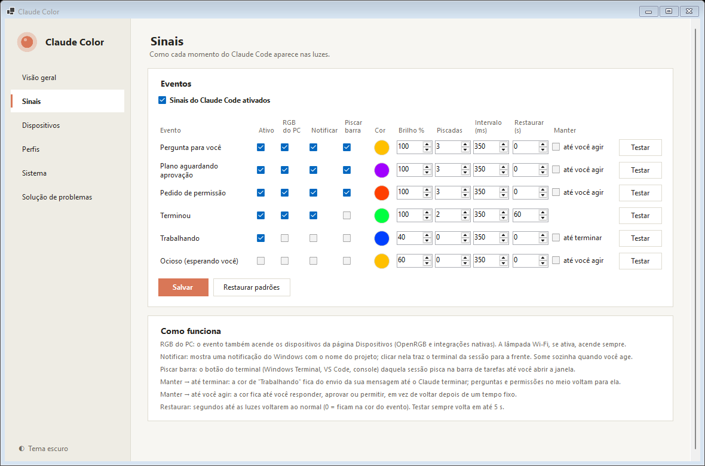
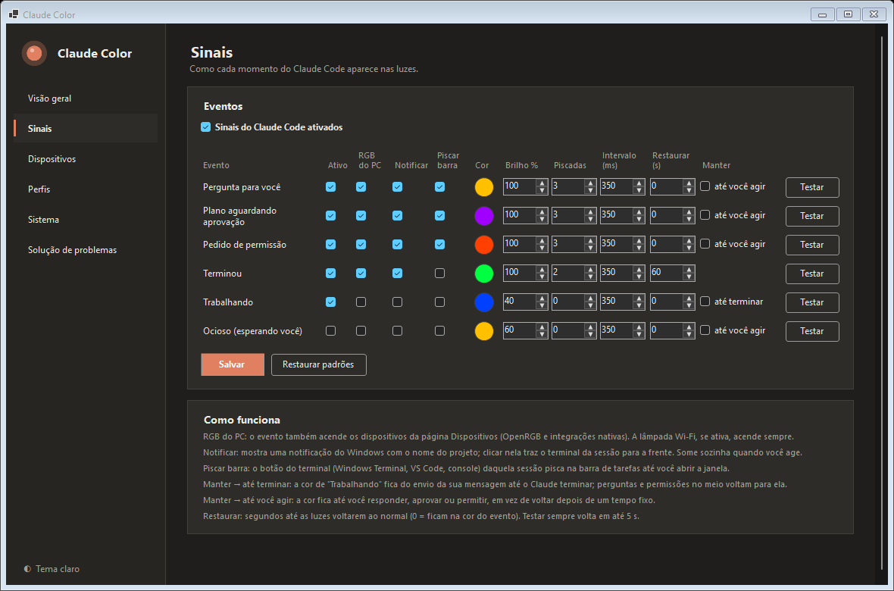
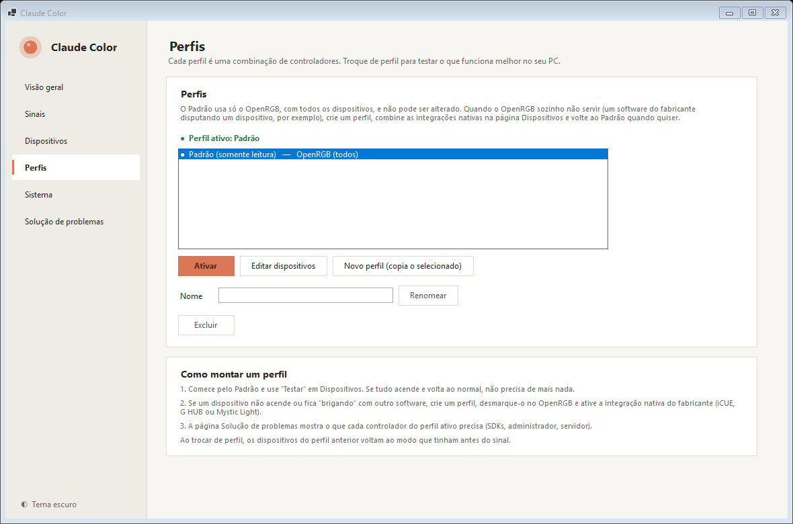
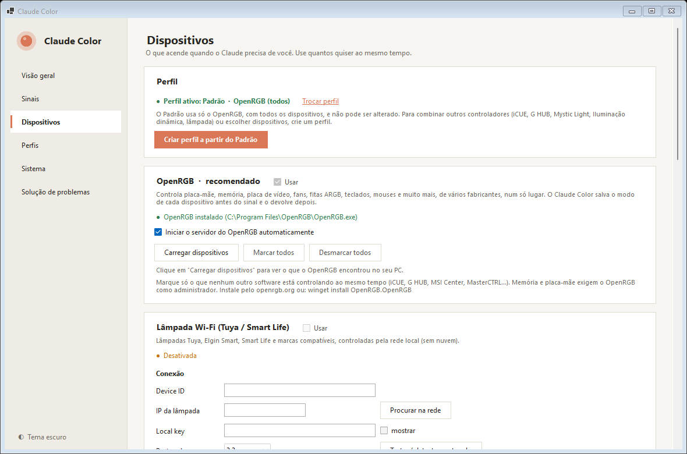

# Claude Color

As luzes RGB do seu PC mostram o que o **Claude Code** está fazendo. Se ele fez uma pergunta, pediu permissão ou está esperando você aprovar o plano, as luzes piscam. Quando ele termina, ficam verdes. Assim dá para fazer outra coisa e saber, de longe, quando o Claude precisa de você.

Funciona com o que você já tem:

- **[OpenRGB](https://openrgb.org)** (recomendado): placa-mãe, memória, placa de vídeo, fans, fitas ARGB, teclados, mouses e [centenas de outros dispositivos](https://openrgb.org/devices.html), de vários fabricantes, num só lugar.
- **Lâmpada Wi-Fi** Tuya / Smart Life / Elgin Smart, pela rede local (sem nuvem).
- **Integrações nativas** opcionais: Corsair iCUE, Logitech G HUB, MSI Mystic Light e, em caráter experimental, a Iluminação dinâmica do Windows 11.

Terminado o sinal, cada dispositivo volta ao modo e às cores que tinha antes.

Sem RGB nenhum também funciona: o Windows mostra uma **notificação** com o nome do projeto, e o botão do terminal da sessão (Windows Terminal, VS Code, console) **pisca na barra de tarefas** até você voltar para ele.

Feito em **.NET 10 / Windows Forms**, para Windows. É um único executável, que fica na bandeja do sistema.

| Tema claro | Tema escuro |
|---|---|
|  |  |

## Sinais padrão

| Evento do Claude Code | Hook | Cor |
|---|---|---|
| Pergunta para você | `PreToolUse` → `AskUserQuestion` | 🟡 amarelo, pisca 3× |
| Plano aguardando aprovação | `PreToolUse` → `ExitPlanMode` | 🟣 roxo, pisca 3× |
| Pedido de permissão | `Notification` (`permission_prompt`) | 🟠 laranja, pisca 3× |
| Terminou | `Stop` | 🟢 verde, volta ao normal após 60 s |
| Trabalhando | `UserPromptSubmit` | 🔵 azul fraco (só na lâmpada, por padrão) |
| Ocioso (esperando você) | `Notification` (`idle_prompt`) | desativado por padrão |
| *(interno)* você agiu | `PostToolUse` | encerra o "até você agir" |

Cor, brilho, piscadas, intervalo e tempo para restaurar podem ser mudados por evento, na página **Sinais**. Na coluna **Manter**:

- **Trabalhando → "até terminar"**: a cor fica acesa do envio da sua mensagem até o Claude terminar (`Stop`). Perguntas, permissões e planos no meio mostram a cor deles e depois voltam para a de trabalhando.
- **Pergunta, plano, permissão e ocioso → "até você agir"**: a cor fica até você responder, aprovar, permitir ou mandar outra mensagem, em vez de voltar depois de um tempo fixo. A ação é detectada pelo hook `PostToolUse`.

As duas opções também terminam com um limite de segurança de 30 min, caso o Claude feche sem avisar.

## Instalação

Para usar: Windows 10 (2004) ou Windows 11 e o Claude Code. O app é um único `ClaudeColor.exe` com o .NET embutido, então não precisa instalar o .NET.

### Baixar

1. Baixe o `ClaudeColor.exe` da [última versão](https://github.com/JoaoXavierDEV/claude-lamp/releases/latest) e coloque numa pasta sua, por exemplo `%USERPROFILE%\.claude-color\bin`.
2. Abra. O exe não é assinado, então o Windows SmartScreen pode avisar: **Mais informações → Executar assim mesmo**.
3. Opcional: confira o hash com o `SHA256SUMS.txt` do Release:
   ```powershell
   (Get-FileHash .\ClaudeColor.exe -Algorithm SHA256).Hash
   ```

### Compilar

Precisa do [.NET 10 SDK](https://dotnet.microsoft.com/download).

```powershell
git clone https://github.com/JoaoXavierDEV/claude-lamp.git claude-color
cd claude-color
dotnet publish src/ClaudeColor.App -p:PublishProfile=win-x64 -o "$env:USERPROFILE\.claude-color\bin"
& "$env:USERPROFILE\.claude-color\bin\ClaudeColor.exe"
```

Para atualizar sem deixar nenhuma luz presa na cor de um sinal, feche o app antes (ele devolve cada dispositivo ao modo original) e publique de novo:

```powershell
& "$env:USERPROFILE\.claude-color\bin\ClaudeColor.exe" --exit
dotnet publish src/ClaudeColor.App -p:PublishProfile=win-x64 -o "$env:USERPROFILE\.claude-color\bin"
```

Na primeira execução, a janela abre na **Visão geral**, que mostra o que falta:

1. **Instalar hooks**: o app adiciona as entradas em `~/.claude/settings.json` (com backup antes) e preserva os hooks de outras ferramentas. Sessões já abertas do Claude Code podem precisar ser reiniciadas.
2. **Escolher dispositivos**: o perfil **Padrão** já usa o OpenRGB com todos os dispositivos. Para a lâmpada ou as integrações nativas, crie um perfil (veja [Perfis](#perfis)).
3. **Testar**: um botão por evento, que volta ao normal em até 5 s.

Se algo não acender, a página **Solução de problemas** confere o que o perfil ativo precisa (Claude Code, hooks, OpenRGB e servidor SDK, DLLs dos SDKs, software do fabricante aberto, administrador, lâmpada na rede) e mostra o link para baixar o que falta.

## Notificações e barra de tarefas

Em **Sinais**, cada evento tem as colunas **Notificar** e **Piscar barra** (por padrão: pergunta, plano e permissão fazem as duas coisas; *terminou* só notifica).

- A notificação diz o evento e o projeto (a pasta em que o Claude Code está). Clicar nela traz o terminal da sessão para a frente. Ela some sozinha quando você age, e uma nova do mesmo projeto substitui a anterior.
- O hook descobre a janela subindo pelos processos que o iniciaram: o console (Windows Terminal ou o console clássico) ou a primeira janela visível de um processo pai (VS Code, JetBrains...).
- Em **Sistema → Notificações e tela cheia**: quando o Windows indica jogo ou vídeo em tela cheia, apresentação ou horário silencioso, o app pode segurar as notificações, a barra de tarefas e, se você quiser, as luzes. O "Não incomodar" do Windows já guarda as notificações na central, sem som.

## Perfis

Um perfil é uma combinação de controladores: OpenRGB (e quais dispositivos dele), iCUE, G HUB, Mystic Light e lâmpada.

- **Padrão**: só o OpenRGB, com todos os dispositivos. Não pode ser alterado nem excluído, e é o ponto de partida em qualquer PC.
- Quando o OpenRGB sozinho não servir (um software do fabricante disputando um dispositivo, por exemplo), crie um perfil na página **Perfis** ou em **Dispositivos → Criar perfil a partir do Padrão** e combine o que funcionar no seu setup. As mudanças em **Dispositivos** ficam salvas no perfil ativo.
- Troque de perfil pela página **Perfis** ou pelo menu da bandeja (**Perfil**). Os dispositivos do perfil anterior voltam ao modo que tinham.
- As credenciais da lâmpada (Device ID, local key, IP) valem para todos os perfis. Os perfis ficam no `config.json`, junto com o resto da configuração.



## OpenRGB

1. Instale: `winget install OpenRGB.OpenRGB` (ou pelo [openrgb.org](https://openrgb.org)).
2. Em **Dispositivos → OpenRGB**, clique em **Carregar dispositivos**. O Claude Color inicia o servidor SDK do OpenRGB (porta 6742) se ele não estiver aberto.
3. Marque o que deve acompanhar o Claude. Por padrão vem marcado tudo o que nenhuma integração nativa ativa já controla.

Cuidados:

- **Um dispositivo, um dono.** Se o iCUE, o G HUB, o MSI Center, o MasterCTRL ou o Armoury Crate também controlam a iluminação de um dispositivo, os dois vão disputar. Desative a iluminação dele no software do fabricante, ou deixe o dispositivo desmarcado no OpenRGB e use a integração nativa.
- **Memória e placa-mãe** (barramento SMBus) só aparecem com o OpenRGB rodando como administrador, e o iCUE pode bloquear o acesso à memória Corsair enquanto estiver aberto.
- O Claude Color usa o protocolo 6 do SDK. No OpenRGB 1.x, clientes com protocolo menor têm a troca de modo ignorada ([issue 5924](https://gitlab.com/CalcProgrammer1/OpenRGB/-/work_items/5924)), e é a troca de modo que permite voltar o dispositivo ao efeito original (por exemplo, *Spectrum*).



### Testado em

| Dispositivo | O OpenRGB enxerga? | Usado por |
|---|---|---|
| Memória Corsair Vengeance RGB Pro DDR4 e Vengeance RGB DDR5 | sim | iCUE (nativo) |
| Placa de vídeo MSI GeForce RTX 2080 Gaming X Trio | sim | MSI Mystic Light (nativo) |
| Placa-mãe ASUS PRIME Z790-P WIFI | sim | iCUE (nativo) |
| Teclado Logitech G512 e mouse G703 | sim | G HUB (nativo) |
| Fans Cooler Master ARGB Gen 2 A1 V2 | sim | OpenRGB |
| Lâmpada Elgin Smart Color A70 (Tuya 3.5) | (não se aplica) | lâmpada Wi-Fi |

Ou seja: nesse PC, só o OpenRGB já cobriria todas as luzes. As integrações nativas ficaram para os dispositivos que já eram controlados pelos softwares dos fabricantes.

## Integrações nativas (opcional)

| Software | Dispositivos | SDK oficial (DLL x64) |
|---|---|---|
| Corsair iCUE | RAM, placa-mãe e o que mais o iCUE expuser | [iCUE SDK 4.x](https://github.com/CorsairOfficial/cue-sdk/releases): `iCUESDK.x64_2019.dll` |
| Logitech G HUB | teclado, mouse e periféricos LIGHTSYNC | [LED SDK](https://www.logitechg.com/sdk/LED_SDK_9.00.zip): `LogitechLedEnginesWrapper.dll` |
| MSI Center (Mystic Light) | placa de vídeo e placa-mãe MSI | `MysticLight_SDK_x64.dll`, instalada com o plugin MSI do iCUE ou com o SDK do MSI Center. **Exige o app como administrador.** |

1. Coloque as DLLs **x64** em `<pasta do app>\x64\`, por exemplo `%USERPROFILE%\.claude-color\bin\x64\`. Elas não são distribuídas neste repositório.
2. No **iCUE**: Configurações → Geral → **Habilitar SDK**. No **G HUB**: permita que jogos e aplicativos controlem a iluminação.
3. **MSI**: na página **Sistema**, use *Reiniciar como administrador* e *Iniciar com o Windows, como administrador* (Tarefa Agendada `ClaudeColor`, sem UAC a cada login). A GPU não pisca: cada chamada ao Mystic Light leva centenas de milissegundos, então ela recebe a cor final logo no início do sinal.

### Iluminação dinâmica do Windows 11 (experimental)

Teclados, mouses e luminárias com suporte a **Iluminação dinâmica** (Configurações → Personalização → Iluminação dinâmica) podem acender sem SDK de fabricante, pela API `Windows.Devices.Lights.LampArray`. Ative em **Dispositivos → Integrações nativas** num perfil próprio.

Limitação: com o app em segundo plano, o Windows só entrega o controle das luzes a apps com identidade de pacote (MSIX) escolhidos naquela tela. O Claude Color não é empacotado, então o dispositivo só acende quando o Windows libera o controle. A página **Solução de problemas** mostra o que o Windows enxerga e se o controle está disponível.

## Opcional: lâmpada Wi-Fi

Lâmpadas com firmware **Tuya**: Elgin Smart (por exemplo, a Smart Color A70 15 W RGB), as que funcionam no app Smart Life / Tuya Smart e muitas marcas "white label". Protocolo local **3.3, 3.4 e 3.5** (implementação própria; a 3.1 funciona via [TuyaNet](https://github.com/ClusterM/tuyanet)), com os formatos de DPs v2 (20–24) e v1 (1–5).

### Obter a *local key*

O controle local precisa do **Device ID** e da **local key**. A local key é obtida uma única vez pela nuvem da Tuya:

1. Crie uma conta de desenvolvedor (gratuita) em **[auth.tuya.com](https://auth.tuya.com/)** e entre em **[platform.tuya.com](https://platform.tuya.com)**.
2. Vá em **Cloud → Development → Create Cloud Project**, com *Industry* = Smart Home, *Development Method* = Smart Home e o data center da sua conta (para o Brasil, **Western America**).
3. No projeto, abra **Devices → Link App Account → Add App Account → Tuya App Account Authorization** e escaneie o QR code pelo app **Smart Life** (aba **Eu**, ícone de scanner).
   > ⚠️ Apps de marca própria (como o **Elgin Smart**) não autorizam esse QR code: ele aparece como *"QR code has expired"*. Remova a lâmpada do app da marca, adicione no **Smart Life** e escaneie por ele.
4. Copie o **Access ID** e o **Access Secret** na aba **Overview** do projeto.
5. Em **Dispositivos → Lâmpada Wi-Fi** (num perfil com a lâmpada ativa), abra *Não tem a local key? Passo a passo da conta Tuya e busca na nuvem* (o mesmo passo a passo está no app), informe região, Access ID e Secret, clique em *Buscar dispositivos* e depois em *Usar selecionado*. O Secret não é salvo.

> Se você parear a lâmpada de novo em algum app, a local key muda e esse passo precisa ser repetido.

### Conectar

- **Procurar na rede** encontra o IP: primeiro pelos anúncios UDP; se o roteador os bloquear, pelos dispositivos com a porta TCP 6668 aberta.
- **Testar / detectar protocolo** tenta 3.5 → 3.4 → 3.3 → 3.1 e salva a versão que responder.
- O **Controle manual** define o estado "normal" da lâmpada, para o qual ela volta depois de cada sinal.

## Uso

- **Bandeja**: um duplo clique abre a janela; o clique direito pausa os sinais. Com a lâmpada ativa, o clique esquerdo liga/desliga e o menu mostra cores, branco e brilho. O ícone assume a cor do último sinal.
- **Janela**: *Visão geral* (o que falta configurar e testes), *Sinais*, *Dispositivos*, *Perfis*, *Sistema* (hooks, administrador, inicialização com o Windows, notificações, log) e *Solução de problemas*.
- **Tema**: claro ou escuro, seguindo o Windows por padrão (modo escuro do Windows Forms no .NET 10, mais a paleta própria do app). O interruptor no fim do menu lateral, o item **Tema escuro** da bandeja e **Sistema → Tema da janela** trocam na hora.
- **Várias sessões do Claude Code**: cada sessão tem o próprio "trabalhando" e "aguardando você". Se você responde numa sessão e outra ainda espera, as luzes voltam para a cor da que espera; a notificação de cada sessão é separada.
- **Hooks vigiados**: a Visão geral e a Solução de problemas mostram quando chegou o último hook. Se o exe estiver marcado "Executar como administrador" (o Claude Code roda sem administrador e não consegue abri-lo), a bandeja avisa e mostra como desmarcar.
- Fechar a janela não encerra o app. Para sair, use **Sair** no menu da bandeja.
- Se um sinal chegar com o app fechado, o hook abre o Claude Color na bandeja (pela Tarefa Agendada elevada, se existir) e o sinal é executado assim que ele inicia. Isso pode ser desligado em **Sistema**.

## Como funciona

```
Claude Code ──hook (JSON no stdin)──► ClaudeColor.exe hook ──► mapeia o evento (retorna em ~150 ms)
                                            ├─► acha a janela do terminal e pisca na barra de tarefas
                                            │
                     app na bandeja aberto? ├─ sim ─► named pipe "ClaudeColor.Signals" ─► app da bandeja
                                            │                                            ├─► notificação do Windows
                                            │                                            ├─► OpenRGB (SDK protocolo 6)
                                            │                                            ├─► lâmpada (TCP 6668)
                                            │                                            ├─► iCUE SDK
                                            │                                            ├─► Logitech LED SDK
                                            │                                            └─► MSI Mystic Light SDK (admin)
                                            └─ não ─► abre o app na bandeja, que executa o sinal pendente
```

- O hook nunca falha e nunca bloqueia: sempre sai com código 0, e o efeito roda no app da bandeja (iniciado via ShellExecute, sem herdar os pipes do Claude Code).
- Os dispositivos recebem o sinal em paralelo, e a falha de um não interrompe os outros. Cada integração tem uma fila própria em que o comando mais recente vence: um dispositivo lento descarta os passos intermediários do piscar e não atrasa os outros.
- O pipe aceita só o usuário atual e tem rótulo de integridade média. Assim, o hook (sem admin) consegue falar com o app mesmo quando ele roda como administrador.
- Cada sinal recebe um número de geração, e um sinal mais novo cancela o "voltar ao normal" de um antigo.
- Um aviso de permissão que chega logo depois de uma pergunta ou de um plano é ignorado, para não trocar a cor mais específica.
- Configuração, estado e log ficam em `%APPDATA%\ClaudeColor\` (`config.json`, `state.json` e `log.txt`). A variável `CLAUDE_COLOR_HOME` muda esse diretório.

### Estrutura

```
src/ClaudeColor.Core          config, eventos e sinais, hooks, pipe, roteamento de dispositivos, protocolo Tuya
  ClaudeHookEvents.cs           evento do hook → sinal; execução dos sinais
  LightTargets.cs               ILightTarget (qualquer coisa que acende durante um sinal)
  DeviceRouting.cs              quem controla cada dispositivo do OpenRGB
  DeviceProfile.cs              perfis de controladores (o Padrão é só OpenRGB)
  TuyaLocalTransport.cs         protocolo local Tuya 3.3 / 3.4 / 3.5 (sessão HMAC + AES-ECB/GCM)
src/ClaudeColor.Rgb           RGB do PC: OpenRGB (cliente próprio, protocolo 6), Corsair (RGB.NET), Logitech e MSI (P/Invoke)
src/ClaudeColor.App           Windows Forms: bandeja, janela e SignalHost
tests/ClaudeColor.Core.Tests  xUnit
```

Para outro tipo de luz, implemente `ILightTarget` (`ShowAsync` e `ReleaseAsync`) e acrescente uma linha `RgbIntegration` no construtor de `PcRgbController`: o alvo, quando ele está ativo na config e o que ele enxerga em "Detectar".

### Desenvolvimento

```powershell
dotnet build
dotnet test
# exe único (o mesmo da instalação), numa pasta de teste:
dotnet publish src/ClaudeColor.App -p:PublishProfile=win-x64 -o .\publish
# prints do README (docs\*.png) com uma config de demonstração, nos dois temas:
.\tools\screenshots.ps1
# PNG de cada página da janela, para revisar o layout:
& src\ClaudeColor.App\bin\Debug\net10.0-windows\ClaudeColor.exe --screenshots .\shots
```

## Vindo do ClaudeLamp (1.x)

O projeto se chamava ClaudeLamp. Na primeira execução, o Claude Color copia `%APPDATA%\ClaudeLamp\config.json` e `state.json` e move os campos da lâmpada para a seção `lamp` (suas escolhas de iCUE, G HUB, MSI e OpenRGB continuam iguais). Depois:

1. Saia do ClaudeLamp antigo pela bandeja.
2. Em **Sistema**, clique em **Instalar / atualizar hooks**. As entradas antigas do `ClaudeLamp.exe` são substituídas.
3. Se usava *Iniciar com o Windows*, ative de novo. A tarefa antiga `ClaudeLamp` é removida.

## Desinstalar

Em **Sistema → Desinstalar** (ou `ClaudeColor.exe uninstall`, com `--purge` para apagar também configuração, perfis e log): o app devolve as luzes, remove os hooks do `~/.claude/settings.json` (com backup), a tarefa agendada, a inicialização com o Windows e o registro das notificações, e abre a pasta do exe para você apagá-la.

## Solução de problemas

A página **Solução de problemas** do app verifica tudo isso automaticamente para o perfil ativo. Os sintomas mais comuns:

| Sintoma | O que verificar |
|---|---|
| Nada acende | Veja em **Solução de problemas** se os hooks estão instalados, quando chegou o último hook e se o perfil ativo tem um controlador. Reinicie a sessão do Claude Code e consulte `log.txt`. |
| Nenhum hook chega (o log não mostra `hook:`) | O `ClaudeColor.exe` não pode estar marcado "Executar como administrador" (Propriedades → Compatibilidade): o Claude Code roda sem administrador e não consegue abri-lo. O app avisa na bandeja. |
| OpenRGB não lista memória ou placa-mãe | Rode o OpenRGB (ou o Claude Color, que o inicia) como administrador, e confira se o iCUE não está segurando o acesso. |
| Cores "brigando" ou voltando sozinhas | Outro software está controlando o mesmo dispositivo. Desmarque-o no OpenRGB ou desligue a iluminação no software do fabricante. |
| Fans não voltam ao modo original | Confira se o MasterCTRL (ou outro software) não está reaplicando as cores, e se o log mostra `openrgb: ... restaurado para '...'`. |
| RAM Corsair não acende pelo iCUE | Confira "Habilitar SDK" no iCUE e se `iCUESDK.x64_2019.dll` aparece como encontrado em **Dispositivos**. |
| GPU MSI não muda pelo Mystic Light | O app precisa estar como administrador (**Sistema**). O log mostra `Mystic Light não inicializou` quando não está. |
| Teclado / mouse Logitech não acendem | Confira se o G HUB está aberto e permite o controle por aplicativos. Se a *Iluminação dinâmica* do Windows estiver ligada para eles, desligue-a. |
| *"QR code has expired"* ao vincular a lâmpada | Use o app **Smart Life**, não o app da marca. |
| *"sign invalid"* ao buscar a local key | Access ID ou Secret copiados errado. Copie de novo pelo ícone de copiar na aba Overview. |
| Lâmpada: timeout / nenhum protocolo responde | Feche o app Smart Life no celular (a lâmpada aceita poucas conexões locais ao mesmo tempo) e confira se a local key é do pareamento atual. |

## Créditos

- [OpenRGB](https://openrgb.org): servidor e especificação do SDK.
- [TinyTuya](https://github.com/jasonacox/tinytuya): referência do protocolo local Tuya.
- [TuyaNet](https://github.com/ClusterM/tuyanet): cliente da API cloud (busca da local key) e do protocolo 3.1.
- [RGB.NET](https://github.com/DarthAffe/RGB.NET): integração com o iCUE SDK e referência das assinaturas do Mystic Light SDK.

## Licença

[MIT](LICENSE). Os SDKs de terceiros (Corsair iCUE SDK, Logitech LED SDK, MSI Mystic Light SDK) não fazem parte deste repositório e seguem as licenças dos respectivos fabricantes.

Projeto independente, sem vínculo com a Anthropic, a Tuya, a Elgin, a Corsair, a Logitech, a MSI, a ASUS ou a Cooler Master. "Claude" é marca da Anthropic; o nome indica apenas que o app acompanha o Claude Code.
